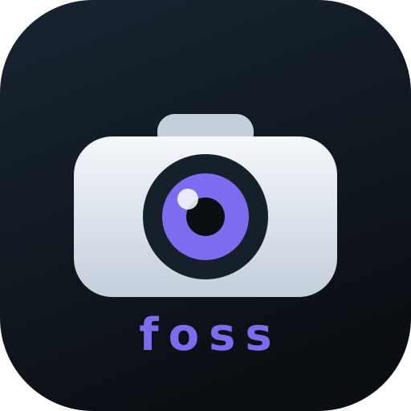

# YooFree

Cliente **aberto e sem anúncios** para câmeras **Yoosee / GW (Gwell)**, para
**Android**.

Fala direto com a câmera na sua rede local: **sem nuvem, sem conta, sem IA,
sem telemetria**. Só você e a sua câmera.

<p align="center">
  
</p>

[](LICENSE)
[](../../releases)
[](../../actions)
[](https://yoofree.qd.je/)
[](https://ko-fi.com/wenningtondaquino)

🌐 **Site oficial:** https://yoofree.qd.je/

---

## Versões

| Plataforma | Pacote | Como instalar |
|---|---|---|
| **Android** 7+ | `YooFree-0.8.apk` (assinado) | baixe na aba [Releases](../../releases) e instale |

Todas as versões fazem a mesma coisa:

- 📹 **Vídeo ao vivo** HEVC/H.265 1080p direto da câmera
- 🕹️ **PTZ**: mover a câmera (cima / baixo / esquerda / direita)
- 🔍 **Zoom** digital de 1x a 5x
- 🎥 **Gravação local** em MP4 (sem re-encode, sem nuvem)
- 🔄 **Girar** a imagem em 90° (útil se a câmera estiver "de cabeça pra baixo")

E o Android ainda tem **modo paisagem** com HUD que esconde, **zoom por gesto** de dois dedos, **som** da câmera e **busca automática** dela na rede.

---

## Novidades da v0.8

- 🛠️ **SETUP mais tolerante a firmware**: o app agora faz `DESCRIBE` e usa os
  tracks que a câmera anuncia no SDP; se não houver SDP, tenta os URIs
  conhecidos com duas variantes de `Transport` (com e sem `mode="PLAY"`)
- 🎧 **Canais intercalados negociados**: passa a respeitar o `interleaved` que a
  câmera devolve no `SETUP` (antes assumia 0/2 fixos, o que podia resultar em
  vídeo/áudio mudos em alguns firmwares)
- 💬 Mensagens de erro explicam o motivo (401/404/405/501) em vez de só repetir
  a linha do RTSP

## Novidades da v0.7

- ✍️ **Build oficial assinado**: o APK agora sai assinado com chave de release
  (antes era debug), gerado pelo GitHub Actions
- 🌐 **Site oficial**: https://yoofree.qd.je/

## Novidades da v0.6

- 🔊 **Som da câmera**: áudio G.711 (A-law/µ-law) tocado no app, com taxa
  adaptativa (8 ou 16 kHz, inferida pelo timestamp RTP) e botão `♪` pra
  ligar/desligar
- 🕹️ **PTZ verificado**: o app agora lê a resposta do `SET_PARAMETER` e avisa
  quando a câmera recusa o comando (antes a resposta era ignorada)

## Novidades da v0.5

- 🤏 **Zoom com os dedos (pinch)**: no Android, aproxime/afaste dois dedos sobre o
  vídeo para dar zoom (1x a 5x), além dos botões `−`/`+`
- 📺 **Modo paisagem estilo player**: os controles agora são um HUD sobre o
  vídeo; **toque na tela** para esconder/mostrar

## Novidades da v0.4

- 🎨 **Interface nova**: visual minimalista e mais amigável — controles redondos,
  painel único de PTZ/zoom/gravação, status como pílula, vídeo com cantos suaves,
  e o painel de conexão some quando você já está conectado
- 🐛 **PTZ para baixo** mandava o comando como `DWON` (typo) — agora vai `DOWN`

## Novidades da v0.3

- 🔎 **Busca automática de câmera na rede**: um botão **Buscar** encontra as
  câmeras RTSP do seu Wi‑Fi (varre a /24 local na porta 554 e confirma o
  handshake RTSP) — não precisa mais descobrir o IP no roteador
- A lista de câmeras encontradas aparece no app; toque no IP pra preencher

## Novidades da v0.2

- 🛠️ **Correção do crash ao Conectar** em alguns aparelhos (ex.: Redmi Note 12S,
  Android 15) — o decoder HEVC agora se recupera sozinho quando o codec cai
- 🛠️ **Câmeras com firmware novo**: resolve o `SETUP 405 Method Not Allowed`
  tentando URIs alternativas aceitas pelo RTSP dessas câmeras

---

## Android

1. Baixe o APK da versão atual na aba [Releases](../../releases).
2. Autorize "instalar de fontes desconhecidas" quando o Android pedir.
3. Abra o app, toque em **Buscar** para achar a câmera na sua rede (ou digite o
   **IP da câmera**, ex.: `192.168.1.2`) e toque em **Conectar**.
4. **PTZ** pelas setas, **zoom** no `−`/`+`, **girar** no botão, **gravar** no botão.
   Os vídeos ficam em `Android/data/br.yoofree.app/files/YooFree/`.

> **Atualizando de uma versão anterior à 0.7?** Desinstale a antiga antes: a 0.7
> em diante é assinada com chave de release, e o Android não deixa instalar por
> cima de uma build com assinatura diferente.

O celular precisa estar no **mesmo Wi‑Fi** da câmera.

---

## Como descobrir o IP da câmera

O jeito mais fácil: **toque em `Buscar`** no app — ele varre o seu Wi‑Fi e lista
as câmeras encontradas.

Se preferir na mão:

1. Configure a câmera normalmente no app oficial da Yoosee.
2. Veja os dispositivos conectados no seu roteador — a câmera aparece com um IP
   tipo `192.168.1.2`.
3. Ou, no app oficial: **Configurações da câmera → Informações da rede**.

> Dica: fixe o IP no roteador (reserva DHCP) pra ele não mudar depois.

---

## Perguntas frequentes

**Preciso da senha da câmera?**
Não. O YooFree usa o RTSP local, que nessa linha não exige autenticação para
`SETUP`/`PLAY`. Só o IP basta.

**Fala com a nuvem da Yoosee?**
Não. A conexão é direta (`IP:554`), na sua rede local.

**Funciona fora de casa?**
Ainda não direto pelo app — o estudo está em
[docs/research/RESEARCH-REMOTE-ACCESS.md](docs/research/RESEARCH-REMOTE-ACCESS.md).
Por enquanto use uma VPN (WireGuard/Tailscale) com a câmera na rede local.

**Por que um cliente RTSP próprio?**
Porque essas câmeras **não falam RTSP padrão**: o `DESCRIBE` responde
`400 Bad Request` quando o cliente manda autenticação, então players prontos
(VLC, ffmpeg, ExoPlayer, GStreamer) não conseguem ler o SDP. O YooFree faz o
mínimo que a câmera aceita (`SETUP` + `PLAY`, e `SET_PARAMETER` para PTZ) e
depacketiza o HEVC na mão.

**Por que o Android não usa o MediaMuxer?**
Porque em vários aparelhos (ex.: Samsung) o `MediaMuxer` **crasha nativamente**
com HEVC. O YooFree tem um **muxer MP4 próprio**, que escreve os boxes na mão.

**Posso usar em mais de uma câmera?**
Hoje conecta em uma por vez (essas câmeras costumam aceitar poucas sessões RTSP
simultâneas). Suporte a múltiplas câmeras está nos planos.

---

## No futuro (implementações e sugestões)

Ideias que estão no radar, em ordem de prioridade — sugestões novas são bem-vindas
nas [issues](../../issues):

- 🏃 **Eventos de movimento via RTSP/ONVIF**: receber os eventos de movimento que
  a própria câmera reporta (no firmware testado o serviço de Events da ONVIF é
  anunciado mas não responde; precisa de captura em hardware pra confirmar)
- 🕹️ **PTZ à prova de câmera**: mover o controle PTZ do canal RTSP para o
  protocolo nativo das câmeras dessa linha (DVRIP/XMeye, porta 34567 — o mesmo
  caminho que os apps oficiais usam), com fallback pro meio atual. Já temos o
  estudo pronto em [docs/research/RESEARCH-PTZ.md](docs/research/RESEARCH-PTZ.md)
- 🌐 **Acessar fora do Wi‑Fi local**: **estudo concluído** — por enquanto a rota
  confiável é VPN (veja [docs/research/RESEARCH-REMOTE-ACCESS.md](docs/research/RESEARCH-REMOTE-ACCESS.md);
  P2P do fabricante é token-gated e não dá pra reimplementar). Túnel embutido no
  app é a evolução possível a médio prazo
- 🎛️ **Direções PTZ normalizadas**: inverter esquerda/direita e cima/baixo
  automaticamente quando a câmera está montada de cabeça pra baixo (como o app
  oficial faz)
- 📷 **Suporte a mais câmeras**: iCSee/XMEye (afinal, é o mesmo protocolo nativo),
  Novus/Dahua/Intelbras (SDK dahua) e afins — o RTSP de vídeo já é o mesmo caminho
- 🔢 **Múltiplas câmeras** no mesmo app, com lista/grid
- 🗑️ (provavelmente **não** vai): câmeras Tuya — o PTZ delas só funciona pela
  nuvem da Tuya, que é oposta ao jeito "sem nuvem" do YooFree

---

## Apoiar o projeto

O YooFree é 100% gratuito, sem anúncio e open source. Se ele te economizou um
app antigo cheio de ad (ou umas semanas de dor de cabeça), tomo um café: ☕

### Pix

<p align="center">
  
</p>

- **Chave Pix (aleatória):** `8eb4ec02-4a67-42b1-b3dc-6243efcd426a`
- **Valor:** o que você escolher (QR também aceita valor livre no app do banco)
- Ou copie o código Pix:

```
00020126360014br.gov.bcb.pix01228eb4ec02-4a67-42b1-b3dc-6243efcd426a5204000053039865802BR5922YooFree62070503***6304
```

### Ko-fi

Pelo Ko-fi dá pra apoiar com cartão ou PayPal, com valor livre:
**https://ko-fi.com/wenningtondaquino**

---

## Estrutura do repositório

```
app/          app Android (Kotlin + Compose)
  .../media/      decoder HEVC, áudio G.711, muxer MP4
  .../net/        busca de câmeras na rede local (LanScanner)
  .../ui/         tema e telas (Compose)
assets/       ícone (SVG) + QR do Pix
site/         página oficial (GitHub Pages)
docs/         pesquisa de protocolo (engenharia reversa dos apps oficiais)
scripts/      toolchain Android local
.github/      workflows (APK assinado e Pages)
```

---

## Compilar do código

**Android** (toolchain isolado, não mexe no sistema):

```bash
bash scripts/setup-toolchain.sh   # JDK 17 + Android SDK
bash scripts/install-gradle.sh    # Gradle 8.9
source scripts/env.sh
./gradlew assembleDebug           # ou assembleRelease
```

O APK oficial (assinado) é gerado pelo GitHub Actions
(`.github/workflows/build.yml`); o site, por `pages.yml`.

Para assinar localmente, coloque no `local.properties` (fora do git):

```
YOOFREE_STORE_FILE=/caminho/keystore.jks
YOOFREE_STORE_PASSWORD=...
YOOFREE_KEY_ALIAS=yoofree
YOOFREE_KEY_PASSWORD=...
```

No CI, os mesmos valores vêm de secrets (`YOOFREE_KEYSTORE_BASE64`,
`YOOFREE_STORE_PASSWORD`, `YOOFREE_KEY_ALIAS`, `YOOFREE_KEY_PASSWORD`) e o build
cai para debug se eles não existirem.

---

## Segurança

- O app é **somente leitura** sobre a câmera (vídeo + PTZ). Não altera firmware.
- A câmera é acessada apenas na **rede local**.
- Recomendado: bloqueie o acesso da câmera à internet no roteador — ela tenta
  falar com servidores na nuvem que não são necessários pra nada aqui.
- Use apenas em câmeras **suas**.

---

## Licença

**GPL-3.0-or-later** — veja [LICENSE](LICENSE). Livre pra usar, estudar e
modificar; derivados continuam abertos.

Documentos oficiais no site:

- Licença: https://yoofree.qd.je/licenca.html
- Política de privacidade: https://yoofree.qd.je/privacidade.html

---

## Contato

- E-mail: **wenningtondiasx25@gmail.com**
- Bugs e sugestões: [issues](../../issues)
